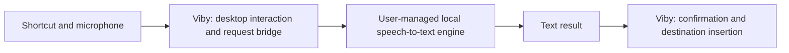

<p align="center">
  
</p>

# Viby

**A Windows dictation bridge for your local AI.**

[](https://github.com/jovi-tsx/viby/actions/workflows/ci.yml)

Viby is designed to connect the Windows desktop to a local speech-to-text
engine that the user chooses, configures, and runs. Viby owns the interaction:
global shortcuts, microphone capture, a compact interface, request handling,
and the planned insertion of returned text into the original application.

The user owns the AI runtime, models, and inference setup. Engine selection
should be configurable at runtime rather than tied to one bundled model.

> **Development stage: pre-alpha.** Releases use numeric SemVer only. See the
> [changelog](CHANGELOG.md) and [release policy](RELEASING.md).
> The code currently contains an embedded Whisper
> prototype. Dynamic connections to user-managed local AI engines are **not
> implemented yet**. Automatic text insertion and release packaging are also
> unfinished. The setup instructions below document the existing prototype,
> while the target architecture describes the new product direction.

## Contents

- [What Viby is for](#what-viby-is-for)
- [Project status](#project-status)
- [Changelog](CHANGELOG.md)
- [Versioning and releases](RELEASING.md)
- [Roadmap and release gates](ROADMAP.md)
- [How it works](#how-it-works)
- [Engine ownership and integration](#engine-ownership-and-integration)
- [Requirements](#requirements)
- [Set up the project](#set-up-the-project)
- [Run in development](#run-in-development)
- [Build and run the executable](#build-and-run-the-executable)
- [Configure the current Whisper prototype](#configure-the-current-whisper-prototype)
- [Use the current prototype](#use-the-current-prototype)
- [Current settings and local storage](#current-settings-and-local-storage)
- [Architecture](#architecture)
- [Privacy and network behavior](#privacy-and-network-behavior)
- [Verification](#verification)
- [Troubleshooting](#troubleshooting)
- [Contributing and license](#contributing-and-license)

## What Viby is for

Viby's intended destination is any Windows application that accepts normal
pasting: an editor, terminal, message field, or form. The app provides a small
dictation interface between those applications and the user's own local AI.

A user should be able to run a compatible local speech-to-text service,
configure Viby to connect to it, and change the engine or model without
recompiling Viby. The engine is responsible for loading models and performing
inference; Viby is responsible for the Windows interaction.

The current source is an early implementation of that interaction and audio
pipeline. It still performs inference through an embedded Whisper adapter.

## Project status

| Area | Current state |
| --- | --- |
| Native Windows shell, tray menu, and Options | Implemented |
| Configurable global dictation and discard shortcuts | Implemented; native interaction verification ongoing |
| WASAPI microphone capture and audio-level feedback | Implemented |
| Embedded Whisper inference and provisional preview | Implemented in the current prototype |
| Dynamic connection to user-managed local AI engines | Planned; integration contract still needs implementation |
| Hold-to-talk and optional press-once confirmation mode | Implemented; remaining native keyboard/regression checks |
| Non-sensitive preferences and local model selection | Implemented |
| Automatic paste into the original destination | Planned |
| Clipboard preservation and optional Enter delivery | Planned with insertion; settings already exist |
| Installers, distribution, and final end-to-end validation | Planned |

See [ROADMAP.md](ROADMAP.md) for the next implementation steps and the gates
for the first usable Windows release.

The Options window already includes insertion preferences. Accepting a
finished take currently resolves the confirmation state without pasting or
sending Enter.

## How it works

### Target architecture

1. The user runs a compatible local speech-to-text engine on their computer.
2. They configure Viby with the engine's supported connection details.
3. A global shortcut starts microphone capture and displays the dock.
4. Viby submits the audio through the configured local integration.
5. The engine returns text; Viby coordinates confirmation and the planned
   insertion into the original Windows destination.



This is the intended architecture. The configurable engine bridge and
destination insertion are still pending.

### Current prototype

The Rust flow controller starts WASAPI capture, mixes audio to mono,
resamples it to 16 kHz, and runs inference through an embedded Whisper worker.
The dock displays microphone level and optional provisional transcription of
recent audio windows. When capture ends, the microphone closes and final
local inference finishes. Confirmation mode waits for accept or discard.

Only the provisional preview is shown as spoken content in the current UI.
There is no full-transcript history, copy panel, or automatic insertion.

## Engine ownership and integration

| Viby is responsible for | The user's local AI engine is responsible for |
| --- | --- |
| Global shortcuts and capture controls | Starting and operating the AI runtime |
| Microphone capture and request coordination | Obtaining, loading, and managing models |
| Connection settings and result handling | Speech recognition and inference |
| Cancellation, errors, and UI state | Hardware acceleration and runtime resources |
| Confirmation and planned Windows insertion | Producing a supported text result from audio |

A compatible integration needs an **audio-in, text-out** contract. Support
depends on the interface the engine exposes or an integration adapter.
A text-only language model needs a separate speech-to-text component before it
can participate in this workflow.

The transport, capability negotiation, and provider configuration have not
been implemented. The current Options window selects a local Whisper file;
it does not yet offer an endpoint/provider selector. The documentation does
not claim that arbitrary AI runtimes can already be connected.

## Requirements

The supported development target is **native Windows with the MSVC toolchain**.
The current workflow has been exercised on x64 Windows.

| Environment | Tools | Purpose |
| --- | --- | --- |
| WSL | Git, Node.js 22 or newer, npm | Editing, frontend dependencies, Vite, TypeScript, and icon generation |
| Windows | Rust stable/MSVC and Cargo | Native compilation and Rust checks |
| Windows | Microsoft C++ Build Tools and Windows SDK | Compiling/linking native Windows and Whisper components |
| Windows | CMake on `PATH` | Building whisper.cpp |
| Windows | LLVM/libclang | Generating the bindings used by whisper-rs |
| Windows | Microsoft Edge WebView2 Runtime | Rendering the local interface |
| Windows | Microphone and compatible local Whisper model | Exercising capture and transcription |

Keep the checkout on a **Windows drive**, and open that same directory from WSL
and Windows. Node/npm run in WSL; they do not need to be installed on Windows.
Rust inside WSL does not replace the Windows MSVC toolchain.

Install the **Desktop development with C++** workload in
[Microsoft C++ Build Tools](https://visualstudio.microsoft.com/visual-cpp-build-tools/),
including a Windows SDK. Install [CMake](https://cmake.org/download/) if needed.

The official [Tauri prerequisites](https://v2.tauri.app/start/prerequisites/)
cover Rust/MSVC, C++ tooling, and WebView2. The
[bindgen requirements](https://rust-lang.github.io/rust-bindgen/requirements.html)
explain LLVM/libclang.

Viby does not require a Python service, transcription API key, or cloud account.
Setup downloads and build dependencies are separate from the app's local
dictation path.

## Set up the project

### 1. Clone on the Windows filesystem

These examples use `C:\src\viby`. If you already have a checkout, substitute its
existing location in both shells.

**WSL:**

```sh
mkdir -p /mnt/c/src
cd /mnt/c/src
git clone https://github.com/jovi-tsx/viby.git
cd viby

node --version
npm --version
npm ci
```

Both JavaScript and Rust lockfiles are included. Use `npm ci` for a reproducible
frontend dependency installation.

### 2. Prepare the Windows toolchain

**Windows PowerShell, in the same checkout:**

```powershell
Set-Location C:\src\viby

rustc -vV
cargo --version
cmake --version

$env:LIBCLANG_PATH = 'C:\Program Files\LLVM\bin'
Test-Path (Join-Path $env:LIBCLANG_PATH 'libclang.dll')

cargo install tauri-cli --version "^2" --locked
cargo tauri --version
```

`rustc -vV` should report a Windows MSVC host, such as
`x86_64-pc-windows-msvc`. The `libclang.dll` check should return `True`.
Adjust `LIBCLANG_PATH` if LLVM is installed elsewhere, and set it in each
terminal used for native builds.

The Cargo CLI is installed on Windows because that environment builds the
native application. The npm Tauri package is also used by WSL icon generation.

### 3. Build the frontend once

**WSL:**

```sh
cd /mnt/c/src/viby
npm run build
```

This runs TypeScript checks and builds both local pages into `dist/`.

## Run in development

Development uses two terminals against the same checkout.

**Terminal A — WSL:**

```sh
cd /mnt/c/src/viby
npm run dev
```

Vite serves the interface at `http://localhost:1420`. The configured port is
fixed; Vite fails rather than silently choosing another port.

**Terminal B — Windows PowerShell:**

```powershell
Set-Location C:\src\viby
$env:LIBCLANG_PATH = 'C:\Program Files\LLVM\bin'
cargo tauri dev
```

The current Tauri configuration does not start Vite automatically. Keep
Terminal A running while using the native development app.

Viby starts in the notification area, with the dock hidden at rest. Open the
taskbar's hidden-icons area if necessary, right-click **Viby**, and select
**Options…**.

Opening the Vite URL in a browser gives you the frontend development surface.
Native microphone, global-shortcut, preference, and window behavior require
the Tauri application.

## Build and run the executable

Build the frontend first; there is no automatic frontend build hook in the
current Tauri configuration.

**WSL:**

```sh
npm run build
```

**Windows PowerShell, from the repository root:**

```powershell
$env:LIBCLANG_PATH = 'C:\Program Files\LLVM\bin'
cargo tauri build --no-bundle

.\src-tauri\target\release\viby.exe
```

The executable is `src-tauri/target/release/viby.exe`. An equivalent Windows
build helper is available:

```powershell
.\scripts\run-release-build.ps1
```

`--no-bundle` builds the native executable without an installer. Packaged
installers and a validated installation flow are still planned. The first
native build can take longer because Rust and whisper.cpp compile native
dependencies.

## Configure the current Whisper prototype

This section applies to the embedded prototype. In the target architecture,
model installation and loading belong to the user's local AI engine.

The current prototype does not bundle weights or download a model during dictation. Obtain a
compatible whisper.cpp **GGML `.bin` model** separately, following the upstream
[model documentation](https://github.com/ggml-org/whisper.cpp/tree/master/models).

Multilingual `base` and `small` models are the current project choices.
Quantized examples used by the project are `ggml-base-q5_1.bin` and
`ggml-small-q5_1.bin`. Start with a multilingual base model when evaluating the
prototype; a larger model uses more resources and may take longer to finish.
English-only `.en` models are not suitable for multilingual dictation.

1. Put the model in a local Windows directory, for example
   `C:\Models\ggml-base-q5_1.bin`.
2. Open **Viby → Options…** from the tray menu.
3. Under **Model and language**, select the matching model family.
4. Enter the **Local model path** using a Windows path, not `/mnt/c/...`.
5. Use `auto` for automatic language detection, or a language code such as `pt`
   or `en`.
6. Click **Save**.

Selecting a model family does not install or convert a model; the file path is
what the native loader opens.

Model paths must resolve to local, available files. URLs, UNC/network locations,
mapped network drives, and cloud-only placeholders are rejected. A "present"
status confirms file existence; an invalid or incompatible model can still
fail when Whisper loads it.

## Use the current prototype

### Default hold-to-talk mode

With **Confirm before inserting** disabled:

1. Focus the application you are working in.
2. Hold the dictation shortcut—by default, **Ctrl+Shift+Space**.
3. Speak while the dock displays microphone activity.
4. Release the shortcut to stop capture and finish local transcription.

The prototype reports completion and hides the dock afterward. It does not
paste the result into the focused application yet.

### Optional confirmation mode

Enabling **Confirm before inserting** also switches activation to press-once:

1. Press the dictation shortcut once to start.
2. Press it again to stop capture and finish transcription.
3. When the dock says **Ready to insert**, press the dictation shortcut to
   accept, or press the discard shortcut to discard.
4. The on-screen accept/discard controls are also available.

The default discard shortcut is **Ctrl+Shift+Backspace**. It resolves a waiting
confirmation only; it does not cancel an active recording. Use the dock's
discard control to cancel active capture or processing.

Accepting currently closes the waiting step. Destination insertion is the next
implementation stage.

### Tray behavior and capture limits

- The tray menu contains exactly **Options…** and **Close**.
- Closing Options closes that preferences window; use tray **Close** to exit.
- Tray **Close** cancels any active flow and disposes of temporary data.
- The dock is hidden at rest and can sit at the bottom left, center, or right.
- Capture is bounded to two minutes; exceeding the limit produces an error.
- Reduced motion follows Windows. Provisional previews can be disabled.

## Current settings and local storage

These settings describe the embedded prototype. Dynamic engine/provider
configuration has not been implemented.

| Setting | Default | Behavior |
| --- | --- | --- |
| Dictation shortcut | `Ctrl+Shift+Space` | Hold-to-talk, or press-once when confirmation is enabled |
| Discard shortcut | `Ctrl+Shift+Backspace` | Discards a waiting confirmation; must differ from the dictation shortcut |
| Input device | System default | Uses the default input or an explicitly selected microphone |
| Model family | `base` | Model choice metadata; supply the matching local file |
| Model path | Unset | Required before transcription |
| Language | `auto` | Automatic detection or an explicit Whisper language code |
| Send Enter after pasting | Off | Preference for the planned insertion adapter |
| Confirm before inserting | Off | Enables press-once capture and the waiting accept/discard step |
| Bar position | Bottom center | Bottom left, center, or right |
| Provisional preview | On | Displays temporary, recent transcription while recording |

Preferences are stored as `preferences.json` in Tauri's application data
directory for `com.viby.local`, normally:

```text
%APPDATA%\com.viby.local\preferences.json
```

The store contains configuration only. Audio, recognized text, and clipboard
contents are not part of its schema. Change settings through Options and save
them explicitly.

## Architecture

The table and source map below describe the current embedded prototype.
The target engine boundary is described in [How it works](#how-it-works).

| Layer | Implementation | Responsibility |
| --- | --- | --- |
| Desktop host | Tauri 2 + Rust | Native lifecycle, tray, windows, commands, and events |
| Interface | Vanilla TypeScript + Vite | Local Options form and bottom dock |
| Capture | CPAL / WASAPI | Audio capture, level measurement, and disposable buffers |
| Speech recognition (current prototype) | whisper-rs / whisper.cpp | Embedded local inference; intended to be replaced by configurable local-engine integration |
| Preferences | tauri-plugin-store | Persisting configuration without dictation content |
| Windows integration | windows-rs | Native window behavior and local-path checks |
| Destination insertion | Planned adapter | Validating the original target and preserving the clipboard |

The flow controller owns activation, cancellation, confirmation, and worker
coordination. The UI receives state/events and requests explicit actions.

```text
assets/branding/           Final SVG, PNG, Illustrator source, and preview
src/main.ts                Dock rendering and flow events
src/options.ts             Preferences UI and native command calls
src/styles.css             Shared visual tokens and styles
src-tauri/src/lib.rs        Setup, commands, and preference persistence
src-tauri/src/flow.rs       Dictation state machine and worker coordination
src-tauri/src/audio.rs      Capture, downmixing, resampling, and limits
src-tauri/src/stt.rs        Local-path validation and Whisper inference
src-tauri/src/prefs.rs      Preference schema, defaults, and validation
src-tauri/src/shortcut.rs   Shortcut parsing and equality
src-tauri/src/bar.rs        Native dock placement and visibility
src-tauri/src/tray.rs       Tray menu, Options window, and shutdown
src-tauri/icons/            Generated native/platform icon assets
scripts/                   Build helpers, smoke checks, and diagnostics
docs/architecture/         Stack and module boundaries
docs/specs/                Behavioral and privacy contract
```

See [the stack](docs/architecture/STACK.md),
[module boundaries](docs/architecture/MODULES.md), and
[ADR 0001](docs/adrs/0001-local-whisper-rust-desktop.md) for design rationale.

## Privacy and network behavior

The target product keeps dictation connected to the user's own local AI.
Communication with a user-managed engine will require a defined local
integration contract; the transport and local-only validation still need
implementation. A cloud provider or remote transcription fallback is outside
this local-engine direction.

The current prototype performs inference in-process through Whisper. It has
no engine-service connection, account, transcription API, remote fallback,
or retained dictation history.

Audio and text are temporary. Cancel, stop/finalization, and exit dispose of
data associated with the flow. Diagnostics record states, counts, timings,
and errors rather than recognized text or clipboard contents.

Internet access is needed to obtain build dependencies and, for the current
prototype, model weights during setup. Development mode connects the WebView
to the local Vite server. Production UI assets are bundled with the executable.

The planned insertion adapter must confirm that the original destination is
safe, preserve unrelated clipboard contents, and keep Enter opt-in.

## Verification

### Frontend — WSL

CI checks version/changelog consistency and the frontend on Linux, then runs
hardware-free Rust tests and Clippy on Windows. UI and spoken checks require
separate native evidence.

```sh
npm ci
npm run build
```

The build runs `tsc` before Vite. `npm run preview` serves the built frontend for
inspection; it does not provide native desktop integrations.

### Rust and native build — Windows

After building the frontend, run from the repository root:

```powershell
$env:LIBCLANG_PATH = 'C:\Program Files\LLVM\bin'

cargo test --manifest-path src-tauri/Cargo.toml --lib
cargo clippy --manifest-path src-tauri/Cargo.toml --all-targets -- -D warnings
cargo tauri build --no-bundle
```

Or use the helpers:

```powershell
.\scripts\run-rust-gates.ps1
.\scripts\run-release-build.ps1
```

Unit tests cover hardware-free behavior such as state transitions, shortcut
validation, preference privacy boundaries, and audio transformations. They do
not replace real microphone, tray, focus, keyboard, or clipboard verification.

### Native smoke checks

These checks use the real Windows desktop. They may launch the app, move focus,
send shortcuts, and temporarily change preferences. Use an available desktop,
inspect the scripts first, and provide your own model paths.

For example, after a release build:

```powershell
.\scripts\smoke-m1.ps1

.\scripts\smoke-keyboard.ps1 `
  -ModelPath 'C:\Models\ggml-base-q5_1.bin' `
  -Variant 'base-q5_1'

.\scripts\smoke-final-result.ps1 `
  -ModelPath 'C:\Models\ggml-base-q5_1.bin' `
  -Variant 'base-q5_1'
```

`smoke-final-result.ps1` requires a real spoken take. The broader
`smoke-bar.ps1` has a `-Spoken` mode and a `-SlowModelPath` parameter for its
processing/cancellation scenarios; inspect its requirements before running it.

Reports and captures stay in ignored local artifact directories. Do not attach
recognized speech or private desktop content to issues. The current suite does
not exercise Narrator or 200% scaling, and native interaction validation remains
incomplete.

### Branding

The [SVG master](assets/branding/viby-icon.svg) supplies Options, favicons, and
generated app/tray icons. The editable
[Illustrator source](assets/branding/viby-icon.ai) is included.

After changing the SVG, run in WSL:

```sh
npm run icons
npm run build
```

Then rebuild on Windows. The Rust build script watches the generated icon
directory so changed artwork is incorporated into the executable resource.
See [branding documentation](assets/branding/README.md).

## Troubleshooting

| Symptom | What to check |
| --- | --- |
| `cargo tauri` is not recognized | Install the Tauri 2 Cargo CLI on Windows and reopen the terminal if Cargo's bin directory was added to `PATH`. |
| `link.exe`, a Windows SDK, or a C++ compiler is missing | Install the C++ desktop workload and Windows SDK; verify that the Windows Rust host is MSVC. |
| `cmake` cannot be found | Make CMake available on Windows `PATH`. |
| bindgen cannot find `libclang` | Set `LIBCLANG_PATH` to the directory containing `libclang.dll` and check it with `Test-Path`. |
| Native development cannot reach port 1420 | Keep `npm run dev` running in WSL and verify Windows can reach `http://localhost:1420`. Port conflicts cause Vite to exit. |
| A production build cannot find `dist/` | Run `npm ci` and `npm run build` in WSL before the native build. |
| Viby launches with no visible window | Look for Viby in the notification area or hidden-icons flyout, then open Options. |
| A shortcut has no effect | Check Options for a registration conflict and choose another modifier/key combination. |
| The model is missing or fails to load | Use a fully local, compatible GGML model and a Windows path. File presence alone does not prove compatibility. |
| The microphone is unavailable | Check the selected input device and Windows microphone access for desktop apps. |
| A take is too short or returns no text | Speak for longer and check that the selected microphone is receiving input. |
| Preview text changes or disappears | It covers recent speech, clears outside recording, and is not a transcript history. |
| I cannot choose an AI endpoint/provider | Dynamic local-engine integration is planned; the current prototype only exposes the embedded Whisper settings. |
| Recognition finishes but nothing is pasted | Automatic insertion is not implemented yet, including when accepting a confirmation. |

## Contributing and license

Issues and focused pull requests are welcome. Read
[CONTRIBUTING.md](CONTRIBUTING.md) and the
[behavioral contract](docs/specs/voice-dictation.md) before changing dictation or
privacy boundaries.

Viby is licensed under the [MIT License](LICENSE). Dependencies retain their
own licenses; see [THIRD_PARTY.md](THIRD_PARTY.md).
