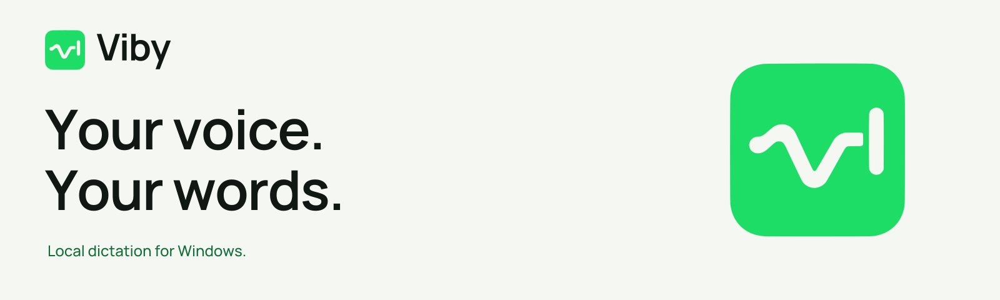
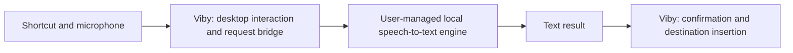

<p align="center">
  
</p>

# Viby

**A Windows dictation bridge for your local AI.**

[](https://github.com/jovi-tsx/viby/actions/workflows/ci.yml)

Viby connects the Windows desktop to a local speech-to-text engine that the
user chooses, configures, and runs. Viby owns the interaction: global
shortcuts, microphone capture, a compact interface, the request to the engine,
and the planned insertion of returned text into the original application.

The user owns the AI runtime, models, and inference setup. Viby bundles,
downloads, and starts no engine, server, or model; it talks to whichever
engine answers its documented request.

> **Development stage: pre-alpha.** Releases use numeric SemVer only. See the
> [changelog](CHANGELOG.md) and [release policy](RELEASING.md).
> Automatic text insertion and release packaging are unfinished; see
> [project status](#project-status).

## Contents

- [What Viby is for](#what-viby-is-for)
- [Project status](#project-status)
- [Changelog](CHANGELOG.md)
- [Versioning and releases](RELEASING.md)
- [Roadmap and release gates](ROADMAP.md)
- [How it works](#how-it-works)
- [Engine ownership and integration](#engine-ownership-and-integration)
- [Brand and identity](#brand-and-identity)
- [Requirements](#requirements)
- [Set up the project](#set-up-the-project)
- [Run in development](#run-in-development)
- [Build and run the executable](#build-and-run-the-executable)
- [Connect your engine](#connect-your-engine)
- [Dictate](#dictate)
- [Current settings and local storage](#current-settings-and-local-storage)
- [Architecture](#architecture)
- [Privacy and network behavior](#privacy-and-network-behavior)
- [Verification](#verification)
- [Troubleshooting](#troubleshooting)
- [Contributing and license](#contributing-and-license)

## What Viby is for

Viby's intended destination is any Windows application that accepts normal
pasting: an editor, terminal, message field, or form. The app provides a small
dictation interface between those applications and the user's own local AI.

A user runs a compatible local speech-to-text service, points Viby at it, and
can change the engine or model without recompiling Viby. The engine loads
models and performs inference; Viby handles the Windows interaction.

## Project status

| Area | Current state |
| --- | --- |
| Native Windows shell, tray menu, and Options | Implemented |
| Configurable global dictation and discard shortcuts | Implemented; native interaction verification ongoing |
| WASAPI microphone capture and audio-level feedback | Implemented |
| Connection to a user-run local engine (OpenAI-style HTTP) and provisional preview | Implemented; native interaction verification ongoing |
| Hold-to-talk and optional press-once confirmation mode | Implemented; remaining native keyboard/regression checks |
| Non-sensitive preferences, engine address, and local-network permission | Implemented |
| Automatic paste into the original destination | Planned |
| Clipboard preservation and optional Enter delivery | Planned with insertion; settings already exist |
| Installers, distribution, and final end-to-end validation | Planned |

See [ROADMAP.md](ROADMAP.md) for the next implementation steps and the gates
for the first usable Windows release.

The Options window already includes insertion preferences. Accepting a
finished take currently resolves the confirmation state without pasting or
sending Enter.

## How it works

1. The user runs a compatible local speech-to-text engine on their computer,
   or on their private network.
2. They enter the engine's address in Viby's Options.
3. A global shortcut starts microphone capture and displays the dock; Viby
   checks that the engine answers as the microphone opens.
4. While the user speaks, recent audio windows go to the engine for a
   provisional preview. When the take ends, the whole take goes for the final
   transcript.
5. The engine returns text; Viby coordinates confirmation and the planned
   insertion into the original Windows destination.



The Rust flow controller starts WASAPI capture, mixes audio to mono, and
resamples it to 16 kHz. Each request is built in memory and never touches
disk. Only the provisional preview is shown as spoken content; there is no
transcript history, copy panel, or automatic insertion yet.

## Engine ownership and integration

| Viby is responsible for | The user's local AI engine is responsible for |
| --- | --- |
| Global shortcuts and capture controls | Starting and operating the AI runtime |
| Microphone capture and the request to the engine | Obtaining, loading, and managing models |
| Connection settings, address checks, and result handling | Speech recognition and inference |
| Cancellation, errors, and UI state | Hardware acceleration and runtime resources |
| Confirmation and planned Windows insertion | Producing a text result from audio |

The contract is **audio in, text out** over HTTP. Viby sends one
`multipart/form-data` `POST`: a `file` part with the take as 16 kHz mono 16-bit
WAV, `response_format=json`, plus `language` and `model` only when you set
them. The engine answers with a JSON object whose `text` field is the
transcript. This is the OpenAI transcription shape
(`/v1/audio/transcriptions`) and the shape of whisper.cpp's own `/inference`,
so whisper.cpp server, Speaches/faster-whisper, LocalAI, vLLM, and similar
servers work. The full contract is R3 and R3a of the
[dictation spec](docs/specs/voice-dictation.md).

A text-only language model needs a separate speech-to-text component before it
can take part. Engines that require an API key are not supported yet, because
Viby stores no credentials.

## Brand and identity

Viby is minimalist and welcoming: the approved waveform V and typing cursor,
a clear voice and a locally bundled typeface. See the
[complete 36-page brandbook](assets/branding/brandbook/viby-brandbook.pdf), the
[brand guide](assets/branding/brand-guide.md), browse the
[visual brand sheet](assets/branding/brand-sheet.html), or
[download the SVG/PNG/source kit](assets/branding/viby-brand-kit.zip).
The final icon remains the source for all platform sizes.

## Requirements

The supported development target is **native Windows with the MSVC toolchain**.
The current workflow has been exercised on x64 Windows.

| Environment | Tools | Purpose |
| --- | --- | --- |
| WSL | Git, Node.js 22 or newer, npm | Editing, frontend dependencies, Vite, TypeScript, and icon generation |
| Windows | Rust stable/MSVC and Cargo | Native compilation and Rust checks |
| Windows | Microsoft C++ Build Tools and Windows SDK | Compiling and linking the native application |
| Windows | Microsoft Edge WebView2 Runtime | Rendering the local interface |
| Windows | Microphone and a local speech-to-text engine you run | Exercising capture and transcription |

Keep the checkout on a **Windows drive**, and open that same directory from WSL
and Windows. Node/npm run in WSL; they do not need to be installed on Windows.
Rust inside WSL does not replace the Windows MSVC toolchain.

Install the **Desktop development with C++** workload in
[Microsoft C++ Build Tools](https://visualstudio.microsoft.com/visual-cpp-build-tools/),
including a Windows SDK.

The official [Tauri prerequisites](https://v2.tauri.app/start/prerequisites/)
cover Rust/MSVC, C++ tooling, and WebView2. No CMake, LLVM, or libclang is
needed: Viby contains no inference code.

Viby does not require a transcription API key or cloud account. Setup
downloads and build dependencies are separate from the dictation path.

## Set up the project

### 1. Clone on the Windows filesystem

These examples use `C:\src\viby`. If you already have a checkout, substitute its
existing location in both shells.

**WSL:**

```sh
mkdir -p /mnt/c/src
cd /mnt/c/src
git clone https://github.com/jovi-tsx/viby.git
cd viby

node --version
npm --version
npm ci
```

Both JavaScript and Rust lockfiles are included. Use `npm ci` for a reproducible
frontend dependency installation.

### 2. Prepare the Windows toolchain

**Windows PowerShell, in the same checkout:**

```powershell
Set-Location C:\src\viby

rustc -vV
cargo --version

cargo install tauri-cli --version "^2" --locked
cargo tauri --version
```

`rustc -vV` should report a Windows MSVC host, such as
`x86_64-pc-windows-msvc`.

The Cargo CLI is installed on Windows because that environment builds the
native application. The npm Tauri package is also used by WSL icon generation.

### 3. Build the frontend once

**WSL:**

```sh
cd /mnt/c/src/viby
npm run build
```

This runs TypeScript checks and builds both local pages into `dist/`.

## Run in development

Development uses two terminals against the same checkout.

**Terminal A — WSL:**

```sh
cd /mnt/c/src/viby
npm run dev
```

Vite serves the interface at `http://localhost:1420`. The configured port is
fixed; Vite fails rather than silently choosing another port.

**Terminal B — Windows PowerShell:**

```powershell
Set-Location C:\src\viby
cargo tauri dev
```

The current Tauri configuration does not start Vite automatically. Keep
Terminal A running while using the native development app.

Viby starts in the notification area, with the dock hidden at rest. Open the
taskbar's hidden-icons area if necessary, right-click **Viby**, and select
**Options…**.

Opening the Vite URL in a browser gives you the frontend development surface.
Native microphone, global-shortcut, preference, and window behavior require
the Tauri application.

## Build and run the executable

Build the frontend first; there is no automatic frontend build hook in the
current Tauri configuration.

**WSL:**

```sh
npm run build
```

**Windows PowerShell, from the repository root:**

```powershell
cargo tauri build --no-bundle

.\src-tauri\target\release\viby.exe
```

The executable is `src-tauri/target/release/viby.exe`. An equivalent Windows
build helper is available:

```powershell
.\scripts\run-release-build.ps1
```

`--no-bundle` builds the native executable without an installer. Packaged
installers and a validated installation flow are still planned.

## Connect your engine

Viby does not install, download, or start an engine or model. Run your own
speech-to-text server, from its own folder, and point Viby at it. For example,
with [whisper.cpp](https://github.com/ggml-org/whisper.cpp)'s server and a
multilingual GGML model you obtained separately:

```powershell
.\whisper-server.exe -m C:\Models\ggml-base-q5_1.bin --host 127.0.0.1 --port 8080 -l auto
```

1. Open **Viby → Options…** from the tray menu.
2. Under **Engine and language**, enter the **Engine address**:
   - a server address such as `http://127.0.0.1:8080` — Viby adds
     `/v1/audio/transcriptions`, the OpenAI path; or
   - a full URL such as `http://127.0.0.1:8080/inference` — used exactly as
     typed (whisper.cpp's own path).
3. Leave **Model name** empty unless your engine asks for one.
4. Use `auto` for automatic language detection, or a code such as `pt` or `en`.
5. Click **Save**.

The address is checked when you save and again before every connection:

- **This PC** (`127.0.0.1`, `::1`, `localhost`) always works, including an
  engine running inside WSL 2 and reached through its forwarded port.
- **Your private network** (`10.x`, `172.16–31.x`, `192.168.x`, `fc00::/7`)
  works only after you turn on **Allow an engine on my local network**. Your
  audio then leaves this PC and crosses that network; use `https` if the
  network is not yours alone.
- **Anything else**, including every internet address, is refused.

The address may not contain a user name, password, query, or fragment.
Redirects are never followed and system proxies are never used.

## Dictate

### Default hold-to-talk mode

With **Confirm before inserting** disabled:

1. Focus the application you are working in.
2. Hold the dictation shortcut—by default, **Ctrl+Shift+Space**.
3. Speak while the dock displays microphone activity.
4. Release the shortcut to stop capture; your engine produces the final text.

Viby reports completion and hides the dock afterward. It does not paste the
result into the focused application yet.

If no engine address is saved, the shortcut is refused before the microphone
opens. If the engine is not running, the take ends as soon as Viby notices.

### Optional confirmation mode

Enabling **Confirm before inserting** also switches activation to press-once:

1. Press the dictation shortcut once to start.
2. Press it again to stop capture and finish transcription.
3. When the dock says **Ready to finish**, press the dictation shortcut to
   accept, or press the discard shortcut to discard.
4. The on-screen accept/discard controls are also available.

The default discard shortcut is **Ctrl+Shift+Backspace**. It discards a waiting
transcript and cancels a take your engine is still processing, in either mode.
It does not cancel an active recording; use the dock's discard control for
that.

Accepting currently closes the waiting step. Destination insertion is the next
implementation stage.

### Tray behavior and capture limits

- The tray menu contains exactly **Options…** and **Close**.
- Closing Options closes that preferences window; use tray **Close** to exit.
- Tray **Close** cancels any active flow and disposes of temporary data.
- The dock is hidden at rest and can sit at the bottom left, center, or right.
- Capture is bounded to two minutes; exceeding the limit produces an error.
- Reduced motion follows Windows. Provisional previews can be disabled.

## Current settings and local storage

| Setting | Default | Behavior |
| --- | --- | --- |
| Dictation shortcut | `Ctrl+Shift+Space` | Hold-to-talk, or press-once when confirmation is enabled |
| Discard shortcut | `Ctrl+Shift+Backspace` | Discards a waiting transcript or cancels engine processing; must differ from the dictation shortcut |
| Input device | System default | Uses the default input or an explicitly selected microphone |
| Engine address | Unset | Required before dictation; checked on save and before every connection |
| Allow an engine on my local network | Off | Permits private-network addresses; audio then leaves this PC |
| Model name | Empty | Sent only when set, for engines that ask for one |
| Language | `auto` | Sent to the engine unless `auto` |
| Send Enter after pasting | Off | Preference for the planned insertion adapter |
| Confirm before inserting | Off | Enables press-once capture and the waiting accept/discard step |
| Bar position | Bottom center | Bottom left, center, or right |
| Provisional preview | On | Displays temporary, recent transcription while recording |

Preferences are stored as `preferences.json` in Tauri's application data
directory for `com.viby.local`, normally:

```text
%APPDATA%\com.viby.local\preferences.json
```

The store contains configuration only. Audio, recognized text, clipboard
contents, and credentials are not part of its schema. Change settings through Options and save
them explicitly.

## Architecture

| Layer | Implementation | Responsibility |
| --- | --- | --- |
| Desktop host | Tauri 2 + Rust | Native lifecycle, tray, windows, commands, and events |
| Interface | Vanilla TypeScript + Vite | Local Options form and bottom dock |
| Capture | CPAL / WASAPI | Audio capture, level measurement, and disposable buffers |
| Engine bridge | reqwest (rustls) | Address checks, the request to the user's engine, timeouts, and cancellation |
| Preferences | tauri-plugin-store | Persisting configuration without dictation content |
| Windows integration | windows-rs | Native window behavior |
| Destination insertion | Planned adapter | Validating the original target and preserving the clipboard |

The flow controller owns activation, cancellation, confirmation, and worker
coordination. The UI receives state/events and requests explicit actions.

```text
assets/branding/           Brand guide, tokens, SVG/PNG kit, Illustrator source
assets/fonts/manrope/      Bundled typeface, original source and license
src/main.ts                Dock rendering and flow events
src/options.ts             Preferences UI and native command calls
src/styles.css             Shared visual tokens and styles
src-tauri/src/lib.rs        Setup, commands, and preference persistence
src-tauri/src/flow.rs       Dictation state machine and worker coordination
src-tauri/src/audio.rs      Capture, downmixing, resampling, and limits
src-tauri/src/engine.rs     Engine address checks, requests, and replies
src-tauri/src/prefs.rs      Preference schema, defaults, and validation
src-tauri/src/shortcut.rs   Shortcut parsing and equality
src-tauri/src/bar.rs        Native dock placement and visibility
src-tauri/src/tray.rs       Tray menu, Options window, and shutdown
src-tauri/icons/            Generated native/platform icon assets
scripts/                   Build helpers, smoke checks, and diagnostics
docs/architecture/         Stack and module boundaries
docs/specs/                Behavioral and privacy contract
```

See [the stack](docs/architecture/STACK.md),
[module boundaries](docs/architecture/MODULES.md), and
[ADR 0002](docs/adrs/0002-user-managed-local-engine.md) for design rationale.

## Privacy and network behavior

Viby's only connections during dictation are to the engine address you
configured, and only after the address passes the checks in
[Connect your engine](#connect-your-engine): this PC always, your private
network only with your permission, the internet never. There is no account,
API key, cloud provider, or remote fallback, and no retained dictation
history.

Audio and text are temporary and never written to disk; audio leaves Viby
only as the body of a request to your engine. Cancel, stop/finalization, and
exit abandon requests in flight and dispose of data associated with the flow.
Diagnostics record states, counts, timings, and errors rather than recognized
text, engine replies, or clipboard contents.

Internet access is needed to obtain build dependencies during setup. Development mode connects the WebView
to the local Vite server. Production UI assets are bundled with the executable.

The planned insertion adapter must confirm that the original destination is
safe, preserve unrelated clipboard contents, and keep Enter opt-in.

## Verification

### Frontend — WSL

CI checks version/changelog consistency and the frontend on Linux, then runs
hardware-free Rust tests and Clippy on Windows. UI and spoken checks require
separate native evidence.

```sh
npm ci
npm run build
```

The build runs `tsc` before Vite. `npm run preview` serves the built frontend for
inspection; it does not provide native desktop integrations.

### Rust and native build — Windows

After building the frontend, run from the repository root:

```powershell
cargo test --manifest-path src-tauri/Cargo.toml --lib
cargo clippy --manifest-path src-tauri/Cargo.toml --all-targets -- -D warnings
cargo tauri build --no-bundle
```

Or use the helpers:

```powershell
.\scripts\run-rust-gates.ps1
.\scripts\run-release-build.ps1
```

Unit tests cover hardware-free behavior such as state transitions, shortcut
validation, preference privacy boundaries, audio transformations, and the
engine bridge against local HTTP and HTTPS test servers. They do
not replace real microphone, tray, focus, keyboard, or clipboard verification.

### Native smoke checks

`smoke-engine.ps1` needs no desktop interaction: it synthesizes a spoken take
with Windows speech and sends it through the production request path to your
running engine.

The other checks use the real Windows desktop. They may launch the app, move
focus, send shortcuts, and temporarily change preferences. Use an available
desktop and inspect the scripts first. Each expects your engine to be running
at `-Endpoint` (default `http://127.0.0.1:8080/inference`).

For example, after a release build:

```powershell
.\scripts\smoke-engine.ps1
.\scripts\smoke-m1.ps1
.\scripts\smoke-keyboard.ps1
.\scripts\smoke-final-result.ps1
```

`smoke-final-result.ps1` requires a real spoken take. The broader
`smoke-bar.ps1` has a `-Spoken` mode; inspect its requirements before running
it.

Reports and captures stay in ignored local artifact directories. Do not attach
recognized speech or private desktop content to issues. The current suite does
not exercise Narrator or 200% scaling, and native interaction validation remains
incomplete.

### Branding

The [SVG master](assets/branding/viby-icon.svg) supplies favicons, generated
app/tray icons and the symbol inside the outlined Options signature. The editable
[Illustrator source](assets/branding/viby-icon.ai) is included. The
[brand kit documentation](assets/branding/README.md) covers signature/font
exports and their reproducible generator.

After changing the SVG, run in WSL:

```sh
npm run icons
npm run build
```

Then rebuild on Windows. The Rust build script watches the generated icon
directory so changed artwork is incorporated into the executable resource.
See [branding documentation](assets/branding/README.md).

## Troubleshooting

| Symptom | What to check |
| --- | --- |
| `cargo tauri` is not recognized | Install the Tauri 2 Cargo CLI on Windows and reopen the terminal if Cargo's bin directory was added to `PATH`. |
| `link.exe`, a Windows SDK, or a C++ compiler is missing | Install the C++ desktop workload and Windows SDK; verify that the Windows Rust host is MSVC. |
| Native development cannot reach port 1420 | Keep `npm run dev` running in WSL and verify Windows can reach `http://localhost:1420`. Port conflicts cause Vite to exit. |
| A production build cannot find `dist/` | Run `npm ci` and `npm run build` in WSL before the native build. |
| Viby launches with no visible window | Look for Viby in the notification area or hidden-icons flyout, then open Options. |
| A shortcut has no effect | Check Options for a registration conflict and choose another modifier/key combination. |
| "No speech engine is set" | Enter your engine's address in Options → Engine and language, and save. |
| "Viby could not reach your speech engine" | Start your engine, and check that its port and path match the address in Options. |
| The address is refused when saving | Use an address on this PC, or turn on **Allow an engine on my local network** for a private address. Internet addresses are always refused. |
| "Your speech engine returned an error (HTTP 404)" | The path is wrong: whisper.cpp serves `/inference` unless started with `--inference-path`. |
| The microphone is unavailable | Check the selected input device and Windows microphone access for desktop apps. |
| A take is too short or returns no text | Speak for longer and check that the selected microphone is receiving input. |
| Preview text changes or disappears | It covers recent speech, clears outside recording, and is not a transcript history. |
| Recognition finishes but nothing is pasted | Automatic insertion is not implemented yet, including when accepting a confirmation. |

## Contributing and license

Issues and focused pull requests are welcome. Read
[CONTRIBUTING.md](CONTRIBUTING.md) and the
[behavioral contract](docs/specs/voice-dictation.md) before changing dictation or
privacy boundaries.

Viby is licensed under the [MIT License](LICENSE). Dependencies retain their
own licenses; see [THIRD_PARTY.md](THIRD_PARTY.md).
