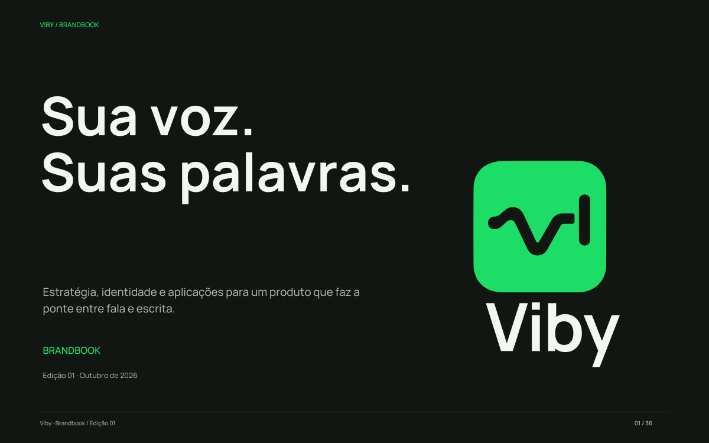

# Viby — Brandbook e aplicações

Edição 01 · 30 de outubro de 2026 · Português

[**Abrir o brandbook completo em PDF**](viby-brandbook.pdf)



## Conteúdo

36 páginas: estratégia e posicionamento, hipóteses de público e jobs, arquétipo
Companheiro/Cara Comum com apoio do Criador, voz e tom, sistema de marca,
respiro/redução/usos incorretos, ícone, 56 cores em cinco famílias, contraste,
papéis semânticos, tipografia, espaço, movimento, aplicações e governança.

Arquétipos são uma escolha de direção criativa. A descoberta registrada é uma
hipótese de trabalho, não uma pesquisa já realizada. Os mocks de conexão dinâmica,
inserção e instalação são identificados como conceitos. Eles não alteram o estado
pré-alpha do aplicativo.

## Aplicações editáveis e exportações

| Pasta / arquivo | Conteúdo |
| --- | --- |
| [applications/](applications/) | SVG/PNG de app icon, desktop, preferências, tray, repositório, instalação e documento com marca d’água |
| [wallpapers/](wallpapers/) | Papel/tinta em 3840 × 2160 e 1440 × 3120, SVG e PNG |
| [watermarks/](watermarks/) | Assinaturas monocromáticas transparentes a 12%, SVG e PNG |
| [palette.json](palette.json) | Fonte das 56 cores com HEX, RGB, HSV e OKLCH, semântica e contraste |
| [palette.csv](palette.csv) / [palette.css](palette.css) | Exportações para planilhas e implementação |
| [content.json](content.json) | Conteúdo editorial e fontes do livro |
| [manifest.json](manifest.json) | Hashes dos arquivos gerados |

Os arquivos de wallpaper PNG estão prontos para usar. SVGs são vetores editáveis;
os textos dentro dos mockups estão em contornos. O PDF tem texto selecionável e
tipografia incorporada. A fonte original e sua licença permanecem no
[kit tipográfico](../../fonts/manrope/SOURCE.md).

O verde #1DDD66 e a geometria do símbolo aprovado foram preservados. A escala
estende os valores existentes; a interface atual não mudou nesta entrega.
Os tokens atuais do app e o estágio de implementação continuam válidos.

## Regeneração (WSL)

Executar a partir da raiz do repositório:

```sh
python3 -m venv /tmp/viby-brandbook-tools
/tmp/viby-brandbook-tools/bin/python -m pip install -r scripts/brandbook-requirements.txt
/tmp/viby-brandbook-tools/bin/python scripts/generate-brandbook.py
/tmp/viby-brandbook-tools/bin/python -m pip install -r scripts/branding-requirements.txt
/tmp/viby-brandbook-tools/bin/python scripts/generate-branding.py
```

O segundo gerador atualiza o kit ZIP completo. Ferramentas de autoria são apenas
dependências de desenvolvimento e não entram no runtime do Viby. A biblioteca
Cairo do WSL é usada para rasterizar os vetores. O gerador não baixa recursos,
não altera o SVG/AI original e não muda preferências do Windows.

O JSON de paleta é o inventário editorial de cores. CSV/CSS e quadros do livro
são derivados dele. Os arquivos de conteúdo, fontes originais e geradores
permitem refazer o PDF; não editar o PDF como fonte principal.

## Critérios de entrega

Todas as páginas são renderizadas para revisão. São conferidos o número de
páginas, texto selecionável, limites, respiro dos mockups, transparência,
dimensões dos wallpapers, cores âncora, ordenação da luminosidade e contrastes.
Um manifesto relaciona os hashes dos vetores, rasters e PDF finais.

Arte e código próprios: MIT. Manrope mantém SIL OFL 1.1.
